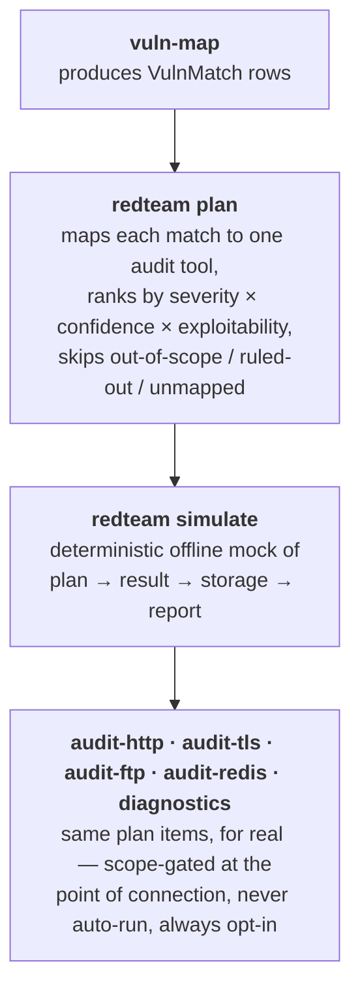
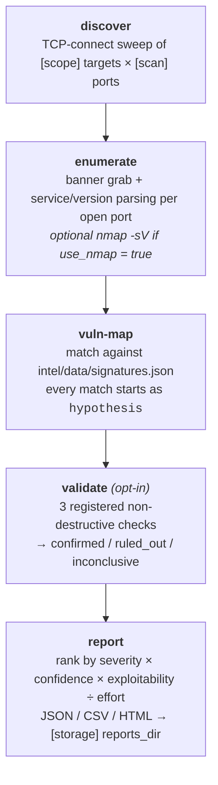

<div align="center">

# Scripter

### Scope-gated red-team automation for Attack-vs-Defense CTFs

**Discover → Enumerate → Map → Validate → Report** — deterministic, offline, and readable end-to-end.

[](#installation)
[](#)
[](#why-scripter)
[](#why-scripter)
[](#installation)
[](#tui-dashboard)

[**Quick start**](#quick-start) ·
[**Scope & safety**](#authorization-and-scope--read-this-first) ·
[**CLI**](#cli-reference) ·
[**TUI**](#tui-dashboard) ·
[**Red-team**](#red-team-extension) ·
[**Installer**](#windows-installer)

</div>

---

**Scripter** automates the repeatable grunt work of an A/D CTF round or an
isolated cyber-range engagement — host/port discovery, service
enumeration, offline vulnerability mapping, and a small set of
non-destructive validation checks — and turns it into **structured,
ranked, exportable findings**.

>  **No AI. No telemetry. No surprises.** Every signature, probe, and
> report is local, deterministic Python you can read end-to-end in an
> afternoon.

> [!IMPORTANT]
> **Scope first, always.** Scripter will not act on anything you have not
> explicitly listed. Read [Authorization and scope](#authorization-and-scope--read-this-first)
> before you run anything.

---

## Table of contents

<table>
<tr>
<td valign="top">

- [Why Scripter](#why-scripter)
- [Authorization and scope](#authorization-and-scope--read-this-first)
- [Quick start](#quick-start)
- [Installation](#installation)
- [Configuration](#configuration)
- [Running](#running)

</td>
<td valign="top">

- [CLI reference](#cli-reference)
- [Red-team extension](#red-team-extension)
- [TUI dashboard](#tui-dashboard)
- [Pipeline](#pipeline)
- [Vulnerability signatures](#vulnerability-signatures)

</td>
<td valign="top">

- [Known limitations](#known-limitations)
- [Windows installer](#windows-installer)
- [Running tests](#running-tests)
- [Project layout](#project-layout)

</td>
</tr>
</table>

---

## Why Scripter

| | |
|---|---|
| **Deterministic** | No LLMs, no heuristics that change between runs — the same scope + signatures always produce the same findings. |
| **Scope-enforced** | Every active function re-checks the target against `[scope] targets` at the moment it fires, not just once at startup. |
| **Honest about confidence** | A signature match is a `hypothesis` until one of three non-destructive checks promotes it to `confirmed` / `ruled_out` / `inconclusive`. |
| **Bounded by design** | Plain TCP connects only — no raw sockets, no SYN scans, no ICMP floods, no evasion tuning, and capped concurrency so a sweep can't become a stress test. |
| **Offline by default** | The signature set ships with the repo. The only third-party call is the opt-in NVD CVE lookup (`[intel] cve_lookup_enabled`, off by default). |
| **One pipeline, two views** | The CLI and the Textual TUI run the exact same `discover → enumerate → vuln-map → validate → report` pipeline. |

---

## Authorization and scope — read this first

> [!WARNING]
> **Only ever point Scripter at systems you are explicitly authorized to test.**

- **No default target.** `[scope] targets` must be a non-empty list of
  hosts/CIDR ranges you're authorized to test (a competition-provided
  range, or an isolated lab network).
- **Public addresses are rejected** unless you explicitly set
  `[scope] allow_public = true` — only do this if the competition itself
  assigns a public range.
- **Re-validated at every probe**, at the point of action — not just
  once at startup.
- **Plain TCP connects only** — no raw sockets, no SYN scanning, no
  ICMP floods, no retry/backoff tuning aimed at evading detection — with
  bounded concurrency (`[scan] max_concurrency`).
- **Validation is opt-in** (`[validate] enabled = true`) and strictly
  non-destructive: an anonymous FTP login attempt, an unauthenticated
  Redis `PING`, and a TLS handshake restricted to legacy protocol
  versions. None write data, authenticate as a privileged user, or
  exploit a bug.
- **Never implemented:** credential brute forcing, known-backdoor
  triggering (e.g. the vsftpd 2.3.4 smiley-face trigger), or any protocol
  exploit that reads/writes target memory or files. See
  [`docs/security-model.md`](docs/security-model.md) for the full list and
  the reasoning.

---

## Quick start

```bash
# 1. install
python3 -m venv .venv && ./.venv/bin/python -m pip install -e .

# 2. configure — set [scope] targets to a range you're authorized to test
cp config/config.example.toml config/config.toml

# 3. go
./.venv/bin/scripter doctor
./.venv/bin/scripter run-all --validate --formats json,csv,html
```

<sub>On Windows, use `.\.venv\Scripts\scripter.exe` and `copy` instead — full
steps below, or grab the [one-click installer](#windows-installer).</sub>

---

## Installation

Works on **Windows and Kali Linux** (and generally any Linux/macOS with
Python 3.11+) — nothing in the codebase is platform-gated.

<details open>
<summary><b>Windows (PowerShell)</b></summary>

```powershell
cd C:\Users\ASUS\Citrus
py -3.12 -m venv .venv
.\.venv\Scripts\python.exe -m pip install --upgrade pip
.\.venv\Scripts\python.exe -m pip install -e .
```
</details>

<details>
<summary><b>Kali Linux / other Linux / macOS (bash)</b></summary>

```bash
cd ~/Citrus
python3 -m venv .venv
./.venv/bin/python -m pip install --upgrade pip
./.venv/bin/python -m pip install -e .
```
</details>

Add test dependencies with `[dev]`, e.g. `-e ".[dev]"`.

> [!TIP]
> **Optional:** install `nmap` and put it on `PATH` for richer version
> detection (`[scan] use_nmap = true`). Kali ships it by default
> (`sudo apt install nmap` elsewhere). Scripter works fine without it —
> it falls back to its own banner-grabbing enumeration.

---

## Configuration

<details open>
<summary><b>Create your config</b></summary>

```powershell
# Windows
copy config\config.example.toml config\config.toml
```

```bash
# Kali / Linux / macOS
cp config/config.example.toml config/config.toml
```
</details>

Edit `config/config.toml` and set `[scope] targets`. Scripter refuses to
run any active command against an empty or missing scope.

| Section | Key | Default | Meaning |
|---|---|---|---|
| `[scope]` | `targets` | `[]` | Hosts/CIDRs you're authorized to test — **required** |
| `[scope]` | `allow_public` | `false` | Allow non-private addresses |
| `[scope]` | `max_hosts` | `4096` | Safety cap against a CIDR typo |
| `[scan]` | `ports` | 28 common ports | Ports probed by discover/enumerate |
| `[scan]` | `timeout_seconds` | `2.0` | Per-connection timeout |
| `[scan]` | `max_concurrency` | `50` | Bounded sweep concurrency |
| `[scan]` | `use_nmap` | `false` | Optional `nmap -sV` enrichment pass |
| `[validate]` | `enabled` | `false` | Opt-in gate for the 3 non-destructive checks |
| `[intel]` | `cve_lookup_enabled` | `false` | Opt-in NVD CVE lookup — the only third-party call |
| `[storage]` | `db_path` | `data/scripter.db` | SQLite run history |

---

## Running

```powershell
# Windows
.\.venv\Scripts\python.exe -m scripter --help
# or, after installation:
.\.venv\Scripts\scripter.exe --help
```

```bash
# Kali / Linux / macOS
./.venv/bin/python -m scripter --help
# or, after installation:
./.venv/bin/scripter --help
```

---

## CLI reference

| Command | What it does |
|---|---|
| `scripter doctor` | Sanity-checks environment + config (nmap on `PATH`, scope size, validate flag) |
| `scripter discover` | TCP-connect sweep of the configured scope |
| `scripter enumerate` | Banner-grabs every open port from the latest (or `--run-id`) run |
| `scripter vuln-map` | Matches enumerated services against the signature dataset |
| `scripter validate` | Runs the 3 non-destructive checks — requires `[validate] enabled = true` |
| `scripter cve-lookup` | Queries the public NVD API per service/version — requires `[intel] cve_lookup_enabled = true` |
| `scripter report --formats json,csv,html` | Writes ranked, machine-readable findings |
| `scripter run-all [--validate] [--formats ...]` | Full pipeline in one shot |
| `scripter tui` | Interactive dashboard over the same pipeline |

```powershell
scripter run-all --validate --formats json,csv,html
```

---

## Red-team extension

`scripter redteam ...` adds an offline **planning** stage plus a set of
bounded, scope-gated **audit tools**, layered on top of the pipeline:



| Command | What it does | Touches the network? |
|---|---|:---:|
| `scripter redteam list-tools` | Lists every registered tool | No |
| `scripter redteam plan` | Builds a deterministic attack plan from a run's vuln-map matches | No |
| `scripter redteam simulate` | Runs the saved plan through the deterministic mock executor | No |
| `scripter redteam audit-http --host H [--port 80]` | Bounded GET + security-header review | Yes |
| `scripter redteam audit-tls --host H [--port 443]` | Certificate metadata + negotiated protocol/cipher | Yes |
| `scripter redteam audit-ftp --host H [--port 21]` | Passive banner + (if `[validate] enabled`) anonymous-login check | Yes |
| `scripter redteam audit-redis --host H [--port 6379]` | Passive banner + (if `[validate] enabled`) unauthenticated-PING check | Yes |
| `scripter redteam diagnostics` | Compares this run's host/port availability against the previous run | No (local DB only) |

> [!NOTE]
> Every real audit is gated by `[redteam] network_audits_enabled = true`
> *and* the existing `scope.require_in_scope` check, on top of each tool's
> own category/validate-enabled gate (see `config/config.example.toml`'s
> `[redteam]` section and [`docs/security-model.md`](docs/security-model.md)).
> `list-tools` / `plan` / `simulate` are deliberately exempt — they're
> offline and deterministic by construction, so there's nothing to gate.

A plan item's result is always one of `completed` / `failed` / `blocked` /
`inconclusive`, and a *simulated* result is always labelled `SIMULATED:`
in its evidence — never mistake a mock run for a real one.

```powershell
# Fully offline: plan + simulate, no target ever contacted
scripter redteam plan
scripter redteam simulate

# Real, explicitly scoped audit (requires network_audits_enabled = true)
scripter redteam audit-http --host 10.10.1.5 --port 80

# Include redteam results in the run's reports
scripter report --redteam --formats json,csv,html
```

---

## TUI dashboard

```powershell
scripter tui
```

A live, keyboard-driven dashboard built on [Textual](https://textual.textualize.io/)
over the exact same pipeline the CLI uses — no second implementation,
just a nicer way to watch it run. Tabs for **Hosts / Services / Findings /
Red Team**, a scrolling log pane, and a status bar showing scope size,
current run id, and whether validation is enabled.

| Key | Action |
|:---:|---|
| <kbd>d</kbd> | **d**iscover — sweep the configured scope |
| <kbd>e</kbd> | **e**numerate — grab banners for the current run's open ports |
| <kbd>m</kbd> | vuln-**m**ap — match services against the signature dataset |
| <kbd>v</kbd> | **v**alidate — run non-destructive checks (if enabled) |
| <kbd>r</kbd> | **r**eport — write JSON/CSV/HTML for the current run |
| <kbd>a</kbd> | run-**a**ll — the full pipeline in one go |
| <kbd>s</kbd> | set/edit **s**cope targets without leaving the TUI |
| <kbd>p</kbd> | redteam-**p**lan — deterministic offline attack plan from current findings |
| <kbd>x</kbd> | redteam-simulate (e**x**ecute, mock) — run the plan through the offline simulator |
| <kbd>q</kbd> | **q**uit |

- Findings are color-coded by **severity** (critical / high /
  medium / low) and **status** (confirmed / hypothesis / inconclusive /
  ruled_out).
- Reopening the TUI against the same `db_path` reloads the latest run
  automatically.
- Real network audits are CLI-only (`scripter redteam audit-*`) for
  now — the TUI's <kbd>x</kbd> only ever runs the offline simulator.

> Every pipeline command operates on a **run** — one `discover`
> invocation and everything chained off it — persisted in SQLite.
> Commands default to the most recent run; pass `--run-id <n>` to target
> an older one.

---

## Pipeline



> [!NOTE]
> Only `validate`'s registered checks can ever promote a match past
> `hypothesis` — a banner/version match alone is a lead, never a finding.

---

## Vulnerability signatures

`src/scripter/intel/data/signatures.json` is a small, honest starting set
of common CTF/lab teaching vulnerabilities:

| | | |
|---|---|---|
| vsftpd 2.3.4 backdoor | ProFTPD 1.3.3c backdoor | UnrealIRCd backdoor |
| Samba `usermap_script` | End-of-life OpenSSH | Tomcat default manager |
| Unauthenticated Redis | Weak TLS | |

It is **not** a comprehensive CVE feed — extend it as you learn the
competition's actual service mix. Each entry marks whether it has an
automated validation check or needs manual confirmation (`"check": null`),
and every `description` says so explicitly.

---

## Known limitations

- Fingerprinting is banner-regex based, not a full protocol-aware
  scanner — it will miss or mis-identify services that don't send an
  identifying banner on connect or an HTTP `Server` header.
- The signature dataset is intentionally small and ships offline. The
  optional NVD lookup is a separate, opt-in enrichment step.
- Automated validation checks exist for only 3 of the 9 bundled
  signatures; the rest are flagged `hypothesis` / manual-review by
  design, not a gap to silently work around.
- `nmap` integration only runs `-sV` — no NSE vulnerability or exploit
  scripts, no `-sS` raw-socket scanning.

---

## Windows installer

A double-click `Scripter-Setup-<version>.exe` (per-user, **no admin
rights**) can be built from `packaging/`.

<details open>
<summary><b>Build</b> — needs Python 3.11+ and the .NET SDK 8+; first build needs network access</summary>

```powershell
powershell -ExecutionPolicy Bypass -File packaging\build-installer.ps1
# -> dist\Scripter-Setup-<version>.exe
```

`packaging\build-app.ps1` builds only the standalone bundle
(`build\app\Scripter`, `build\payload.zip`) in a private venv at
`build\venv`.
</details>

<details>
<summary><b>Install</b></summary>

Run the exe, pick a folder (default `%LOCALAPPDATA%\Programs\Scripter`)
and options (PATH, Start Menu, Desktop). Re-running it upgrades in place.

```powershell
Setup.exe --silent [--dir <path>] [--no-path] [--no-startmenu] [--desktop]
```

Your config, database and reports live in
`%LOCALAPPDATA%\Scripter\workspace` (override with `SCRIPTER_HOME`) and
survive upgrades.
</details>

<details>
<summary><b>Uninstall</b></summary>

Settings › Apps › Scripter, or run `Uninstall.exe` in the install folder
(`--uninstall --silent` for unattended; add `--remove-workspace` to also
delete your data). Only files, shortcuts, the PATH entry and registry
keys recorded in `install-manifest.json` are removed.
</details>

---

## Running tests

```powershell
# Windows
.\.venv\Scripts\python.exe -m pip install -e ".[dev]"
.\.venv\Scripts\python.exe -m pytest -q
```

```bash
# Kali / Linux / macOS
./.venv/bin/python -m pip install -e ".[dev]"
./.venv/bin/python -m pytest -q
```

Tests that need real network access are marked `@pytest.mark.network` and
excluded by default (see `pyproject.toml`'s `testpaths`); run
`pytest -m network` against a real lab target to include them explicitly.

---

## Project layout

```
src/scripter/
├── cli.py              Typer CLI — one command per pipeline stage, shared --config
├── scope.py            Explicit-opt-in scope validation (the one choke point
│                       every active command must pass through)
├── config.py           TOML config loading + validation
├── models.py           Shared dataclasses: Host, ServiceFinding, VulnMatch, ...
├── recon/              Active probing — always scope-gated
│   ├── discovery.py        TCP-connect host/port sweep, bounded concurrency
│   └── enumeration.py      Banner grab + regex-based service/version parsing
├── intel/              Vulnerability intelligence
│   ├── vuln_db.py          Load/validate the signature dataset
│   ├── matcher.py          ServiceFinding → VulnMatch (status = hypothesis)
│   ├── cve_lookup.py       Opt-in NVD CVE lookup
│   └── data/signatures.json
├── validation/         Non-destructive proof-of-vulnerability checks
│   └── checks.py
├── prioritize.py       Score/rank matches by severity × confidence × exploitability
├── storage/db.py       SQLite: runs/hosts/services/vuln_matches
├── reporting/report.py JSON/CSV writers + escaped static HTML
└── tui/app.py          Textual dashboard
```

 See [`docs/architecture.md`](docs/architecture.md) for the full
data-flow walkthrough and [`docs/security-model.md`](docs/security-model.md)
for the complete safety rationale — including exactly why each of the
three validation checks is non-destructive and what Scripter deliberately
never automates.

<div align="center">

<sub>Built for CTFs. Scope first, always.</sub>

</div>
